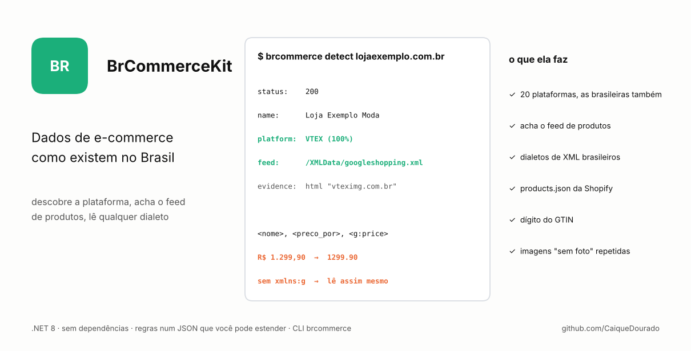
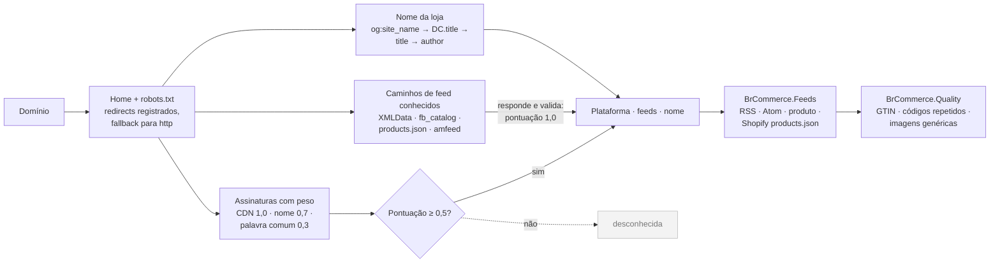
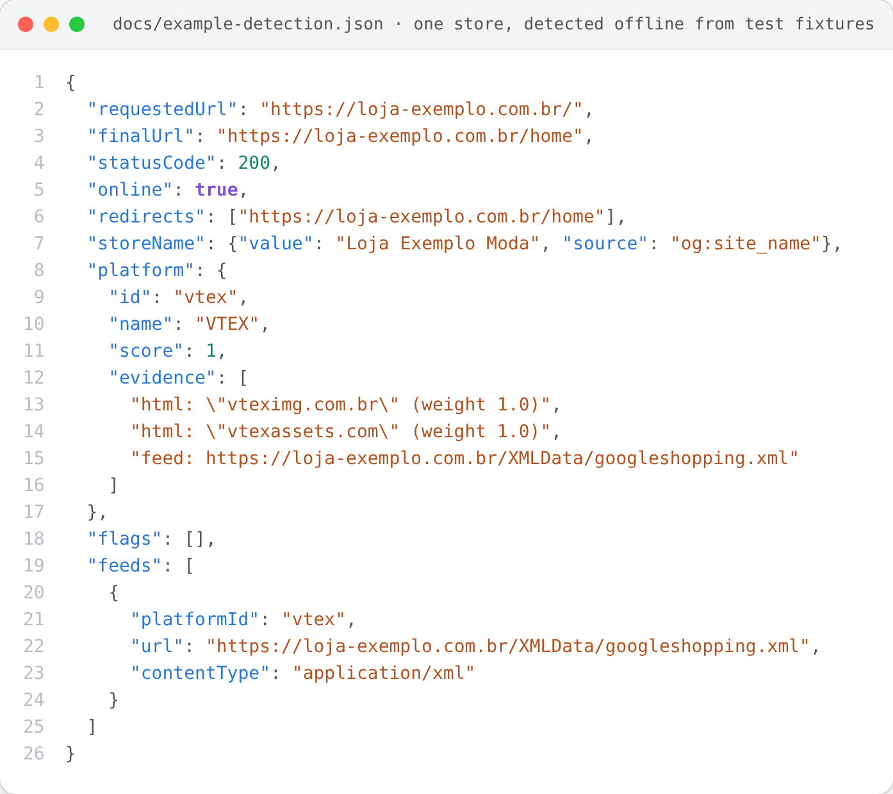

# BrCommerceKit

[](https://github.com/CaiqueDourado/BrCommerceKit/actions/workflows/ci.yml)
[](LICENSE)




**Kit para dados de e-commerce do jeito que eles existem no Brasil.** Descubra em qual plataforma uma loja roda e onde estão os feeds de produto, leia esses feeds em qualquer dialeto e encontre problemas de catálogo que só aparecem olhando milhares de produtos.

[Read in English](README.md)

```text
$ brcommerce detect lojaexemplo.com.br
https://lojaexemplo.com.br/
  status:    200
  name:      Loja Exemplo Moda  [og:site_name]
  platform:  VTEX (100%)
  feed:      https://lojaexemplo.com.br/XMLData/googleshopping.xml
```

## Por quê

Ferramentas genéricas (Wappalyzer, BuiltWith) conhecem as grandes plataformas globais, mas deixam passar a maioria das brasileiras — Loja Integrada, Nuvemshop, Tray, VNDA, Moovin, Wbuy, Iluria, Xtech, JET, E-com Club, EzCommerce, UOL Loja — e nenhuma **encontra o feed de produtos**. Os leitores de feed, por sua vez, esperam XML do Google Merchant impecável, enquanto os feeds reais usam `nome`, `preco_por`, `disponibilidade` e `ean`, repetem `<price>` e `<g:price>`, esquecem de declarar `xmlns:g` e escrevem preço como `R$ 1.299,90`.

Esta biblioteca nasceu de anos rastreando e normalizando catálogos de milhares de lojas brasileiras. As regras e os casos de borda vêm da prática; o código é uma reescrita limpa e testada.

As lojas em que essas regras foram testadas estão publicadas em [lojas-virtuais-brasil](https://github.com/CaiqueDourado/lojas-virtuais-brasil): 63.974 lojas virtuais brasileiras com a plataforma lida pelos mesmos três testes (declarada, nomes no HTML, caminho do feed).

Para baixar as páginas quando a loja responde 403 ou precisa de JavaScript, veja a [scrapladder](https://github.com/CaiqueDourado/scrapladder): ela sobe do HTTP comum até o navegador e lembra, por domínio, o que funcionou.

## Pacotes

| Pacote | O que faz |
| --- | --- |
| **BrCommerce.Detect** | Detecta a plataforma (20 plataformas + sinais como "loja suspensa"), descobre feeds em caminhos conhecidos e extrai o nome da loja. As regras ficam num JSON que você pode estender. |
| **BrCommerce.Feeds** | Leitor em streaming para Google Merchant RSS/Atom, catálogo do Facebook e dialetos brasileiros; leitor do `products.json` do Shopify com variantes; preço e disponibilidade; perfil de feed. |
| **BrCommerce.Quality** | Dígito verificador de GTIN/EAN; identificadores repetidos em produtos sem relação; imagens "sem foto" repetidas entre marcas. |
| **BrCommerce.Cli** | Ferramenta de linha de comando `brcommerce`. |

Sem dependências de terceiros: só a biblioteca base do .NET.

## Instalação

```bash
git clone https://github.com/CaiqueDourado/BrCommerceKit.git
cd BrCommerceKit
dotnet build -c Release
dotnet run --project src/BrCommerce.Cli -- detect lojaexemplo.com.br
```

Cada versão publica os pacotes `.nupkg` e a CLI na página de [Releases](https://github.com/CaiqueDourado/BrCommerceKit/releases).

## Uso

### Detectar uma loja

```csharp
using BrCommerce.Detect;

using var detector = new PlatformDetector();
var resultado = await detector.DetectAsync("lojaexemplo.com.br");

Console.WriteLine(resultado.StoreName?.Value);  // "Loja Exemplo Moda"
Console.WriteLine(resultado.Platform?.Name);    // "VTEX"
foreach (var feed in resultado.Feeds)
    Console.WriteLine(feed.Url);
```

Como decide:



1. Lê a home (seguindo e registrando redirects, com fallback para http) e o `robots.txt`.
2. Aplica assinaturas com peso: um CDN da plataforma, como `vteximg.com.br`, vale 1.0; uma palavra curta e comum, como `tray`, vale 0.3 e nunca decide sozinha. Todos os padrões usam limite de palavra (o antigo `Contains("jet")` casava com "projeto").
3. Testa os caminhos de feed conhecidos. Um feed que responde e passa na validação leva a nota a 1.0. Páginas que devolvem a home com status 200 para qualquer caminho são descartadas.
4. Extrai o nome: `og:site_name` → `application-name` → `DC.title` → `<title>` (com regras para títulos de Xtech e JET) → "Razão Social" → `author`/`copyright`.

Para adicionar ou melhorar uma plataforma, veja [docs/rules.md](docs/rules.md).

### Como fica uma detecção

`DetectAsync` numa loja que redireciona para `/home`, serve uma página VTEX e responde em `XMLData/googleshopping.xml`,
serializado como `brcommerce detect --json` imprime. As páginas vêm das fixtures dos testes, então nenhuma requisição sai da máquina.



JSON completo: [`docs/example-detection.json`](docs/example-detection.json), gerado por
[`scripts/make_json.py`](scripts/make_json.py) via [`tools/DetectExample`](tools/DetectExample/Program.cs).

### Ler um feed

```csharp
using BrCommerce.Feeds;

await using var stream = await FeedSource.OpenAsync("https://lojaexemplo.com.br/XMLData/googleshopping.xml");
foreach (var p in ProductFeedReader.Read(stream))
    Console.WriteLine($"{p.Title} | {p.EffectivePrice} | {p.Availability} | {p.Gtin}");
```

Entende `item`, `entry`, `product` e `produto`; campos com ou sem `g:` e `google_`; nomes em português (`nome`, `descricao`, `preco_de`, `preco_por`, `disponibilidade`, `marca`, `ean`, `link_produto`, `link_imagem`...). Lê item por item, então feeds grandes não precisam caber na memória, e detecta gzip sozinho.

| Entrada | Resultado |
| --- | --- |
| `R$ 1.299,90` | 1299,90 BRL |
| `1299.90 BRL` | 1299,90 BRL |
| `AR$ 15.000` | 15000 ARS |
| `1.299` | 1299 (um único separador seguido de três dígitos é de milhar) |

### Auditar um catálogo

```csharp
using BrCommerce.Quality;

Gtin.IsValid("7891000315507");                                        // true
var repetidos = CatalogQualityAnalyzer.FindSharedIdentifiers(itens);    // mesmo EAN numa geladeira e num tênis
var semFoto = CatalogQualityAnalyzer.FindPlaceholderImages(itens);
```

Um EAN ou uma foto de verdade pertencem a um produto só. Quando o mesmo valor aparece em produtos cujos nomes começam com palavras diferentes e cujas marcas diferem (marcas genéricas como "Importado" não contam), quase certamente é um placeholder.

## Uso responsável

As ferramentas se identificam no User-Agent, fazem pausas entre requisições e só leem páginas e feeds públicos. Não trocam proxies nem fingem ser navegador. Respeite o `robots.txt`, os limites de acesso e os termos de uso dos sites.

## Como contribuir

Plataformas novas, caminhos de feed e casos reais são muito bem-vindos — a maioria das contribuições é uma regra no `rules.json` e um teste. Veja [CONTRIBUTING.md](CONTRIBUTING.md).

## Licença

[MIT](LICENSE) © Caique Dourado
